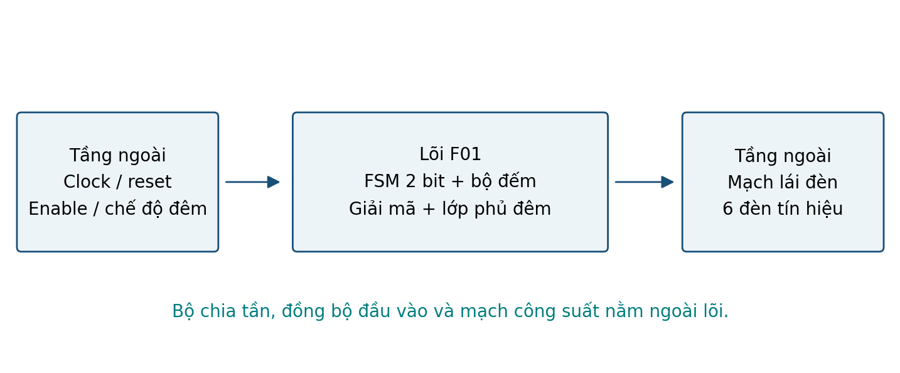
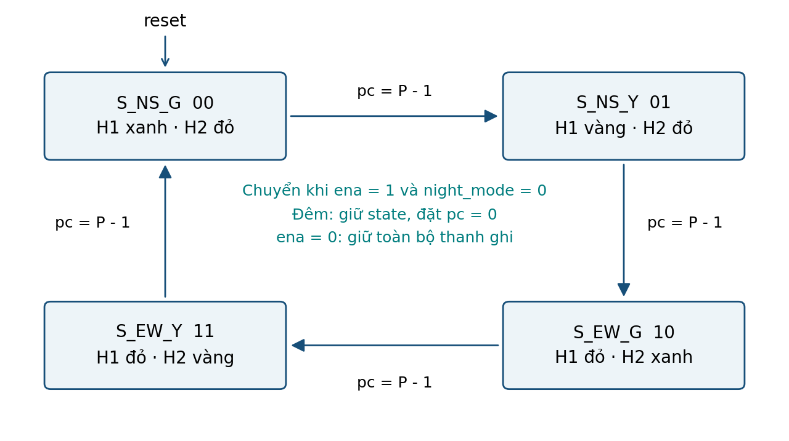
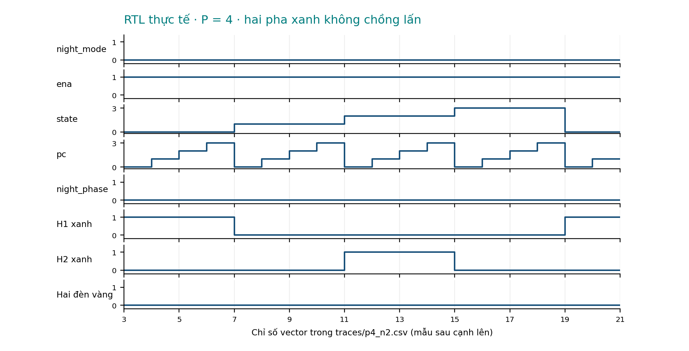
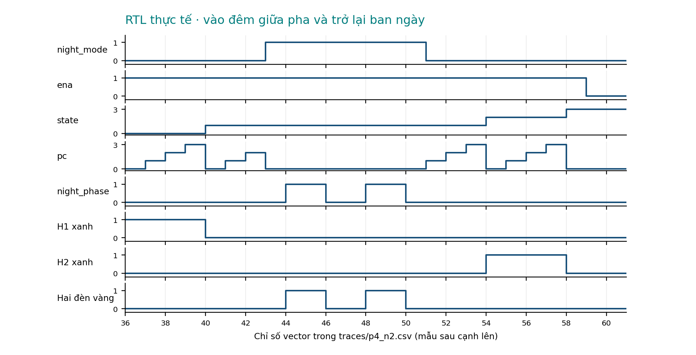

# TRƯỜNG ĐẠI HỌC PHENIKAA


<!-- Trang 1 -->

BÁO CÁO BÀI KIỂM TRA SỐ 2

Môn EEE703128 · Nhập môn Thiết kế Vi mạch Tích hợp

Mã đề F01 · Nhóm F · Mạch tuần tự

| Thông tin | Nội dung |
| --- | --- |
| Sinh viên | Đặng Việt Quang |
| Mã số sinh viên | 24101108 |
| Lớp | N01 |
| Giảng viên hướng dẫn | Thầy Đinh Văn Nam |
| Ngày kiểm tra | 28/10/2026 |
| Top RTL | f01_traffic_fsm_explicit |
| Cấu hình mặc định | PHASE_TICKS = 4; NIGHT_TICKS = 2 |

## Cổng A và đường dẫn kiểm tra

Repo GitHub: CHƯA CÓ URL REPO - cần bổ sung trước khi nộp

GitHub Actions run: CHƯA CÓ URL CI RUN - chưa chạy trên GitHub

Commit mã nguồn và bằng chứng: 6dca91d1a0f2429bcc04390b00eeb04c6aa68f82

Trạng thái: đã kiểm tra RTL, SAT và tổng hợp logic cục bộ; Cổng A chỉ hoàn tất khi repo và CI có URL thật, mở được.

Hà Nội, tháng 10 năm 2026

# Mục lục và tóm tắt


<!-- Trang 2 -->

| Nội dung theo charter | Trang |
| --- | --- |
| 1 Mục tiêu dự án | 3 |
| 2 Bản chất mạch và sơ đồ trạng thái | 4 |
| 3 Rủi ro kỹ thuật chính và kiểm soát | 5 |
| 4 Trọng tâm phân tích và số liệu netlist | 6 |
| 5 Giao diện và sơ đồ chân | 7 |
| 6 Ca kiểm thử và kết quả dạng sóng | 8-9 |
| 7 Phạm vi · 8 Kế hoạch · 9 Bàn giao | 10 |
| 10 Kết quả flow và hướng dẫn Ubuntu GitHub | 11-12 |
| 11 Kết luận · 12 Tự kiểm · Tài liệu tham khảo | 13 |
| Phụ lục thông tin tái lập | 14 |

## Tóm tắt

Đề tài xây dựng lõi FSM bốn pha cho hai hướng giao thông, có lớp phủ nhấp nháy vàng ban đêm. Báo cáo trình bày hành vi, sơ đồ trạng thái, ánh xạ chân, kiểm thử, tổng hợp và chẩn đoán bước thiết kế vật lý theo charter F01 [1].

Lần chạy ngày 28/10/2026 trên Ubuntu 24.04.3 LTS hoàn tất 6.296 vector RTL với sáu cấu hình tham số. Mỗi vector đối chiếu ngõ ra trước và sau cạnh lên, thanh ghi nội bộ và wrapper. Cấu hình mặc định kiểm đủ 224 cạnh của 28 trạng thái mở rộng có thể đạt tới. Yosys SAT xác nhận tính loại trừ hai đèn xanh trong mô hình logic ổn định.

Tổng hợp bằng Yosys 0.33 sinh 53 cell tổng quát, trong đó có 6 flip-flop và không có latch. Hai bit trạng thái được giữ nguyên, phù hợp với bốn pha. Đây là netlist logic tổng quát, chưa ánh xạ sang standard cell SKY130; không dùng số cell này để suy ra diện tích vật lý.

Lần thử LibreLane dừng ở lỗi thiếu module và chưa có PDK. Hồ sơ lưu log, mã thoát và chẩn đoán. Chưa có số liệu STA, power, CTS, DRC/LVS hoặc GDS từ lần chạy này. Repo và CI phải được hoàn tất bằng URL thực trước khi nộp.

Quy ước: H1/H2 là hai hướng; R/Y/G là đỏ/vàng/xanh; P = PHASE_TICKS; N = NIGHT_TICKS. Tick là cạnh lên được cho phép cập nhật khi ena = 1.

# 1 Mục tiêu dự án


<!-- Trang 3 -->

## Vị trí trong hệ thống thực

Khối F01 nằm giữa tầng tạo nhịp và lựa chọn chế độ với tầng mạch lái đèn. Tầng trên cung cấp clock, reset, tín hiệu cho phép và chế độ đêm; tầng dưới nhận sáu mức logic điều khiển đèn. Lõi không trực tiếp cấp dòng cho đèn giao thông.



## Nhu cầu của tầng trên

Tầng trên cần trình tự H1 xanh → H1 vàng → H2 xanh → H2 vàng, thời lượng pha xác định, khả năng dừng cập nhật và chuyển sang đêm giữa chừng. Mã pha 2 bit được xuất ra để giám sát. Yêu cầu an toàn là hai ngõ ra xanh không đồng thời bằng 1 ở giá trị logic ổn định.

## Mục tiêu kiểm chứng và đầu ra

| Mục tiêu | Bằng chứng được tạo |
| --- | --- |
| Chức năng đúng | RTL, mô hình chuẩn, vector, testbench và log PASS cho sáu cấu hình. |
| Quan sát theo thời gian | Sáu VCD, trace CSV và hai hình dạng sóng trích từ RTL. |
| Đọc tổng hợp | netlist.v, netlist.json, synth_stat.txt, summary.json và yosys.log. |
| Thử flow vật lý | Cấu hình LibreLane, log lỗi, mã thoát và danh sách thiếu môi trường. |
| Tái lập và xem bài | Script Ubuntu, workflow GitHub Actions, báo cáo và URL repo/CI khi được công bố. |

Các file mới tập trung vào việc chạy lại và tạo bằng chứng. RTL _explicit của gói hướng dẫn được giữ nguyên hành vi; bản gốc được lưu riêng trong 08_ORIGINAL_SOURCE để đối chiếu [2].

# 2 Bản chất mạch


<!-- Trang 4 -->

F01 là mạch tuần tự: state, pc, nc và night_phase lưu lịch sử và cập nhật tại cạnh lên clk. Logic tổ hợp tính next và giải mã đèn. Bốn pha được mã hóa nhị phân 00, 01, 10, 11; chế độ đêm là lớp phủ ngõ ra, không tạo thêm pha giao thông [2].



| Pha | Mã | H1 {R,Y,G} | H2 {R,Y,G} | uo_out |
| --- | --- | --- | --- | --- |
| S_NS_G | 00 | 001 | 100 | 0x21 |
| S_NS_Y | 01 | 010 | 100 | 0x62 |
| S_EW_G | 10 | 100 | 001 | 0x8C |
| S_EW_Y | 11 | 100 | 010 | 0xD4 |

Khi ena = 1 và night_mode = 0, mỗi pha giữ P tick; bộ đếm chạy 0 đến P - 1. Với P = 4, một vòng bốn pha cần 16 tick. Các giá trị là số tick kiểm thử, chưa đại diện cho giây vận hành thực tế.

Khi vào đêm, state giữ nguyên, pc về 0 tại cạnh được cho phép. Hai đèn vàng cùng sáng nếu night_phase = 1, cùng tắt nếu bằng 0; mỗi nửa chu kỳ dài N tick. Khi trở lại ban ngày, pha được giữ tiếp tục với bộ đếm bắt đầu lại từ 0, không cộng tiếp phần thời gian cũ.

# 3 Rủi ro kỹ thuật chính và kiểm soát


<!-- Trang 5 -->

| Rủi ro | Cách kiểm soát và lỗi được bắt |
| --- | --- |
| Sai một tick | Đối chiếu pc và state ở mọi cạnh; chạy P = 1 và P = 3, 5 để phát hiện lỗi ngưỡng hoặc tràn bộ đếm. |
| Reset bị ena chặn | Kiểm rst_n = 0 đồng thời ena = 0; yêu cầu cả bốn thanh ghi về giá trị reset. |
| Nhầm reset đồng bộ | Đổi rst_n giữa hai cạnh; kiểm state chưa đổi trước cạnh lên tiếp theo. |
| Vào/ra đêm sai | Vào đêm giữa pha, kiểm state giữ và pc xóa; khi thoát, kiểm pha cũ đủ thời lượng mới. |
| Đóng băng không đủ | Khi ena = 0, so sánh state, pc, nc và night_phase cả ban ngày lẫn đêm. |
| Kiểm sai top hoặc chân | Mọi mô phỏng và tổng hợp dùng _explicit; wrapper Tiny Tapeout được so sánh ngõ ra mỗi vector. |
| Kết luận vượt dữ liệu | Tách cell tổng quát khỏi SKY130; giữ log lỗi vật lý; chỉ nêu số liệu có artifact gốc. |

## Thứ tự ưu tiên cập nhật

| Điều kiện tại cạnh lên | state | pc | nc và night_phase |
| --- | --- | --- | --- |
| rst_n = 0 | 00 | 0 | 0 và 0 |
| rst_n = 1; ena = 0 | Giữ | Giữ | Giữ |
| ena = 1; night_mode = 1 | Giữ | 0 | Đếm N tick rồi đảo nháy |
| ena = 1; ngày; pc < P - 1 | Giữ | pc + 1 | 0 và 0 |
| ena = 1; ngày; pc = P - 1 | Pha kế | 0 | 0 và 0 |

## Đoạn RTL quyết định thời điểm cập nhật

```text
always_ff @(posedge clk) begin
    if (!rst_n) begin
        state <= S_NS_G; pc <= '0; nc <= '0; night_phase <= 0;
    end else if (ena) begin
        state <= next;
        // Timer ngay hoac timer nhap nhay duoc cap nhat tai day.
    end
end
```

Reset tích cực thấp nhưng đồng bộ vì danh sách nhạy chỉ có posedge clk. Ngõ ra vẫn phụ thuộc night_mode, nên reset khi đang đêm không tự buộc đèn sang mẫu ban ngày. Đầu vào ngoài lõi phải ổn định khi lấy mẫu; việc đồng bộ tín hiệu bất đồng bộ thuộc tầng tích hợp.

# 4 Trọng tâm phân tích


<!-- Trang 6 -->

## Chứng minh hai hướng không cùng xanh

Gọi s1 = state[1], s0 = state[0], M = night_mode; G1 = uo_out[0], G2 = uo_out[3]. Từ bảng giải mã ở trang 4, với đầu vào nhị phân ổn định:

```text
G1 = (1 - M)(1 - s1)(1 - s0)
G2 = (1 - M)     s1 (1 - s0)
G1 * G2 = (1 - M)(1 - s0)(1 - s1)s1 = 0
```

Hai đèn xanh cần hai giá trị đối nhau của s1 nên không cùng bằng 1. Mô hình duyệt đủ 16 tổ hợp state, M, night_phase. Kiểm SAT trên chính RTL, với thanh ghi ban đầu và đầu vào xác định nhưng không ấn định giá trị, cũng đạt safe = 1 ở bước thời gian được xét [3].

```text
bash 04_IMPLEMENTATION/scripts/03_check_safety.sh
# logs/safety_sat.log:
SAT proof finished - no model found: SUCCESS!
```

Đây là chứng minh ngõ ra logic ổn định, không kiểm trễ cổng, glitch hoặc metastability. Phép SAT này không thay thế kiểm thời lượng pha; phần đó được testbench đối chiếu với mô hình chuẩn.

## Câu phân tích riêng đối chiếu số flip flop

| Nhóm thanh ghi | Số bit RTL P = 4, N = 2 | Netlist JSON Q |
| --- | --- | --- |
| state | ceil(log2 4) = 2 | [12, 13] |
| pc | ceil(log2 4) = 2 | [25, 26] |
| nc | ceil(log2 2) = 1 | [14] |
| night_phase | 1 | [19] |
| Tổng | 6 | 6 cell $_SDFFE_PN0P_ |

Lệnh 02_run_synth.sh tạo synth_stat.txt: 53 cell tổng quát, trong đó 6 FF; 47 cell còn lại là logic tổ hợp. netlist.json nối trực tiếp hai bit state tới Q của hai FF. Tổng 6 FF khớp dự đoán, không phải có 6 bit mã hóa pha [4].

Log FSM_DETECT ghi “Register is connected to module port” và “Users of register don’t seem to benefit from recoding”. Trong lần chạy này Yosys không đổi state sang one-hot. Nếu dùng one-hot, riêng pha cần 4 FF và tổng dự tính là 8 bit ở cùng bộ đếm; phải đo lại mới kết luận diện tích hoặc timing.

# 5 Giao diện và sơ đồ chân


<!-- Trang 7 -->

Lõi có clk, rst_n, ena, night_mode và uo_out[7:0]. Wrapper tt_um_f01 ánh xạ night_mode từ uio_in[0] theo charter; các chân uio đều là đầu vào. Clock, reset và ena thuộc giao diện điều khiển riêng, không cộng vào 9 chân dữ liệu đang sử dụng [1, 2].

| Tín hiệu | Chiều | Rộng | Mức tích cực và giả định |
| --- | --- | --- | --- |
| clk | Vào | 1 | Cạnh lên; clock logic của lõi. |
| rst_n | Vào | 1 | Thấp; reset đồng bộ, ưu tiên cao hơn ena. |
| ena | Vào | 1 | Cao; cho phép cập nhật thanh ghi. |
| uio_in[0] | Vào | 1 | Cao: đêm; thấp: bốn pha bình thường. |
| uo_out[2:0] | Ra | 3 | H1 {R,Y,G}; từng đèn tích cực cao. |
| uo_out[5:3] | Ra | 3 | H2 {R,Y,G}; từng đèn tích cực cao. |
| uo_out[7:6] | Ra | 2 | Mã pha nhị phân 00-11, vẫn giữ khi đêm. |
| ui_in[7:0] | Vào | 8 | Không sử dụng trong thiết kế này. |
| uio_in[7:1] | Vào | 7 | Không sử dụng. |
| uio_out[7:0] | Ra | 8 | Gán 0; không lái ra chân khi oe = 0. |
| uio_oe[7:0] | Ra | 8 | Gán 0; mọi chân uio ở chiều vào. |

## Ánh xạ từng đèn

| Bit uo_out | 7 6 | 5 | 4 | 3 | 2 | 1 | 0 |
| --- | --- | --- | --- | --- | --- | --- | --- |
| Chức năng | state | H2 đỏ | H2 vàng | H2 xanh | H1 đỏ | H1 vàng | H1 xanh |

## Moore và Mealy

Trong chế độ ban ngày, ngõ ra đèn chỉ phụ thuộc state nên có dạng Moore. Khi xét toàn lõi, night_mode đi trực tiếp qua logic tổ hợp để ghi đè sáu đèn, tạo phụ thuộc kiểu Mealy. uo_out[7:6] vẫn chỉ phản ánh state.

Vì ena chỉ khóa thanh ghi, đổi night_mode khi ena = 0 vẫn có thể làm đèn đổi ngay. Đây là hành vi được kiểm trước cạnh lên trong testbench. Không suy luận “ena = 0 thì mọi ngõ ra giữ nguyên”.

Giả định P và N là số nguyên dương, tín hiệu điều khiển có giá trị 0/1 ổn định. Cả bốn mã state đều hợp lệ; lỗi lật bit có thể chuyển sang pha hợp lệ khác nên nhánh default không tạo bảo vệ lỗi vật lý.

# 6 Ca kiểm thử tối thiểu và bổ sung


<!-- Trang 8 -->

Testbench dùng cùng top _explicit với tổng hợp. Python sinh đầu vào và giá trị mong đợi; SystemVerilog đối chiếu uo_out trước/sau cạnh lên, state, pc, nc, night_phase và ngõ ra wrapper. Điều khiển đổi tại cạnh xuống để tránh tranh chấp với cập nhật thanh ghi.

| Ca kiểm | Thực hiện | Lỗi được phát hiện |
| --- | --- | --- |
| Bắt buộc 1 | Hai vòng bốn pha ở cả sáu cấu hình. | Sai thứ tự hoặc thiếu pha; lệch thời lượng. |
| Bắt buộc 2 | Vào đêm giữa pha, nháy rồi trở lại ngày. | Mất pha cũ; không xóa pc; sai thời lượng khi trở lại. |
| Bắt buộc 3 | Kiểm hai đèn xanh ở mỗi vector, bảng giải mã và SAT. | Vi phạm loại trừ an toàn của hai hướng. |
| Bổ sung 1 ca biên | P = 1, N = 1; P = 3, 5. | Sai $clog2, ngưỡng đếm hoặc dùng tràn tự nhiên khi P không là lũy thừa 2. |
| Bổ sung 2 | ena = 0 trong ngày/đêm; đổi chế độ. | Chỉ khóa state nhưng vẫn chạy timer; nhầm khóa ngõ ra. |
| Bổ sung 3 | Reset khi ena = 0 và khi đang đêm. | Reset bị enable chặn; giữ sót bộ đếm hoặc bit nháy. |
| Bổ sung 4 | Đổi reset giữa cạnh, kiểm trước và sau cạnh lên. | Reset bất đồng bộ ngoài đặc tả. |
| Bổ sung 5 | 600 vector giả ngẫu nhiên/cấu hình, seed cố định. | Tương tác giữa reset, enable và đêm mà ca ngắn có thể bỏ sót. |

## Kết quả RTL ngày 28 tháng 10 năm 2026

| P | N | Vector đối chiếu | Kết quả |
| --- | --- | --- | --- |
| 1 | 1 | 640 | PASS |
| 2 | 2 | 659 | PASS |
| 3 | 3 | 678 | PASS |
| 4 | 2 | 2862 | PASS |
| 5 | 3 | 705 | PASS |
| 8 | 4 | 752 | PASS |

Tổng 6.296 vector đều PASS. Cấu hình P = 4, N = 2 gồm 2.862 vector, trong đó 2.176 vector reset/phát lại đường đi để kiểm đủ 224 cạnh của 28 trạng thái mở rộng. Trạng thái mở rộng là bộ (state, pc, nc, night_phase), không phải 28 pha đèn. Mỗi cấu hình còn kiểm reset đồng bộ riêng trước khi đọc vector.

# 6 Kết quả dạng sóng RTL


<!-- Trang 9 -->



Ở các vector 3-20, pc đếm đủ bốn giá trị trước khi đổi pha. H1 xanh và H2 xanh thuộc hai khoảng khác nhau; pha vàng nằm giữa hai hướng xanh. Trục ngang là chỉ số vector, mỗi vector có một cạnh lên kiểm tra; mốc thời gian thực nằm trong CSV và VCD.



Tại vector 43-50, night_mode = 1, state giữ ở 01 và pc = 0. Hai đèn vàng sáng/tắt theo nhịp N = 2. Vector 51 trở lại ngày; state vẫn 01, pc bắt đầu đếm lại. Pha 10 xuất hiện tại vector 54. Hai hình được vẽ từ traces/p4_n2.csv của mô phỏng, không lấy từ mô hình Python.

```text
gtkwave 05_VERIFICATION/waveforms/p4_n2.vcd
```

# 7 Phạm vi dự án


<!-- Trang 10 -->

Trong phạm vi: đặc tả, sơ đồ trạng thái, RTL, wrapper chân, kiểm thử có mô hình chuẩn, dạng sóng, chứng minh logic an toàn, tổng hợp và lần thử flow vật lý có log. Ngoài phạm vi: cảm biến xe, đèn bộ hành, xe ưu tiên, phối hợp nhiều nút giao, chế tạo chip và đánh giá tủ điều khiển thực tế.

Tín hiệu RTL là logic. Việc dùng số tick để điều khiển đèn ngoài đời cần bộ chia tần, đồng bộ đầu vào, mạch công suất và yêu cầu an toàn hệ thống bổ sung.

# 8 Kế hoạch thực hiện

| Mốc | Đầu ra | Trạng thái |
| --- | --- | --- |
| M1 Đặc tả | Giao diện, giả định, FSM và ngưỡng bộ đếm. | Đã có. |
| M2 RTL và kiểm thử | Ca bắt buộc, ca thêm, sáu VCD và log. | Đã chạy PASS. |
| M3 Flow và CI | Tổng hợp; thử vật lý; repo và CI. | Tổng hợp đạt; vật lý lỗi môi trường; chưa có URL GitHub. |
| M4 Phân tích | FF, mã hóa, cell và giới hạn STA/physical. | Có số liệu logic; vật lý cần môi trường. |
| M5 Báo cáo | 14 trang kể cả bìa và phụ lục; chuẩn bị vấn đáp. | Nội dung hoàn tất; chờ repo/CI để chốt Cổng A. |

Charter chưa điền thời hạn cụ thể cho từng mốc. Các mốc phụ thuộc theo thứ tự M1 → M2 → M3 → M4 → M5; không tự đặt ngày nộp thay giảng viên.

# 9 Bàn giao và tiêu chí nghiệm thu

| Sản phẩm | Vị trí và điều kiện kiểm tra |
| --- | --- |
| Repo cá nhân và CI | Push lịch sử Git lên tài khoản cá nhân, chạy workflow và điền URL thật. Cổng A hiện chưa khép. |
| RTL và kiểm thử | 04_IMPLEMENTATION/rtl; 05_VERIFICATION; đọc README trước khi chạy. |
| Artifacts hoặc log lỗi | 05_VERIFICATION/logs, waveforms, traces; 06_GDSII/synthesis và physical. |
| Báo cáo và tái lập | Bản PDF, bản Word và thông tin trang 14. Tất cả lệnh chạy từ thư mục gốc repo. |

Nghiệm thu cục bộ yêu cầu script kiểm RTL/SAT/tổng hợp trả về 0; lỗi vật lý phải có log và mã thoát riêng. CI xanh của workflow cơ bản chỉ xác nhận các bước này, không xác nhận đã tạo GDS hoặc đạt timing vật lý.

# 10 Kết quả flow RTL to GDSII


<!-- Trang 11 -->

## Các kết quả được đo trong lần chạy này

| Bước | Kết quả thực tế | Bằng chứng |
| --- | --- | --- |
| Python và RTL | 6.296 vector; 6/6 cấu hình PASS. | 05_VERIFICATION/logs và vectors/summary.json |
| SAT logic an toàn | SUCCESS; safe = 1 theo mô hình nhị phân ổn định. | logs/safety_sat.log |
| Yosys synth | 53 cell tổng quát; 6 FF; không latch; state 2 bit. | 06_GDSII/synthesis/synth_stat.txt và netlist.json |
| LibreLane | Không khởi động được flow; mã thoát 1. | 06_GDSII/physical/flow.log và exit_code.txt |
| PDK và công cụ vật lý | PDK_ROOT chưa đặt; chưa có LibreLane, OpenROAD, Magic, Netgen, KLayout. | 06_GDSII/physical/environment.json |

```text
python3 -m librelane 04_IMPLEMENTATION/scripts/config_librelane.json
# Ket qua:
.../python3: No module named librelane
# exit_code.txt: 1
```

## Chẩn đoán nguyên nhân và bước khắc phục

Lỗi xảy ra trước khi công cụ đọc cấu hình thiết kế, nên chưa thể đánh giá floorplan, placement, CTS hoặc routing. Cần chuẩn bị môi trường LibreLane đồng bộ bộ công cụ theo tài liệu chính thức, cùng PDK sky130A tương thích; ghi phiên bản LibreLane và commit PDK rồi chạy lại 04_run_physical.sh [6].

| Báo cáo còn thiếu | Nội dung cần đọc khi có lần chạy thành công |
| --- | --- |
| STA | Startpoint/endpoint, loại đường, setup/hold, slack, WNS/TNS và đường chưa ràng buộc. |
| Power | Leakage, internal, switching; góc PVT và giả định hoạt động. |
| CTS | Số buffer, clock skew và insertion delay; ảnh hưởng setup/hold. |
| DRC và LVS | Số lỗi, loại lỗi và sự khớp kết nối layout/netlist. |
| Layout và GDS | Diện tích core/die, cell sau layout, mật độ, ảnh placement/routing và file GDS. |

Không dùng lại các giá trị SKY130 32 cell, 279,0176 µm², 1,18 ns hoặc 27,6 µW ghi trong tài liệu hướng dẫn vì thiếu báo cáo gốc của lần chạy tương ứng. Kết quả 53 cell ở đây thuộc ánh xạ tổng quát nên không so trực tiếp như cùng một phép đo.

# 10 Chạy trên Ubuntu và đưa lên GitHub


<!-- Trang 12 -->

## Chạy từ thư mục gốc dự án

```text
sudo apt update
sudo apt install -y iverilog yosys python3 git gtkwave
bash 04_IMPLEMENTATION/scripts/run_all.sh
gtkwave 05_VERIFICATION/waveforms/p4_n2.vcd
```

run_all.sh dừng với lỗi nếu RTL, SAT hoặc tổng hợp thất bại. Bước vật lý được thử và giữ nguyên mã lỗi/log; thiếu môi trường vật lý không che lỗi kiểm chức năng. Có thể chạy riêng make sim, make synth hoặc make physical.

## Các thư mục thầy cần xem

| Đường dẫn trong repo | Nội dung |
| --- | --- |
| 04_IMPLEMENTATION/rtl | Mã SystemVerilog lõi và wrapper Tiny Tapeout. |
| 04_IMPLEMENTATION/scripts | Lệnh mô phỏng, tổng hợp, SAT và thử LibreLane. |
| 05_VERIFICATION | Mô hình, testbench, vector, log, VCD, trace. |
| 06_GDSII | Netlist và thống kê logic; log/chẩn đoán flow vật lý. |
| 07_TRACEABILITY | Thông tin môi trường, commit và URL repo/CI. |
| .github/workflows/verify.yml | CI cài Icarus/Yosys trên Ubuntu và tải artifacts. |
| 08_ORIGINAL_SOURCE | Bản nguồn thầy cung cấp để đối chiếu. |

## Đẩy lịch sử Git và lấy link CI

Dùng Git bundle đi kèm để khôi phục lịch sử đã tạo trong quá trình chuẩn bị. Tạo một repo trống trên GitHub, lấy URL thật rồi thay REMOTE_URL trong các lệnh dưới đây [5].

```text
git clone F01_history.bundle F01
cd F01
git remote remove origin
git remote add origin REMOTE_URL
git push -u origin main
```

Mở tab Actions, chọn “F01 RTL and synthesis”, mở lần chạy của commit vừa push và lấy URL của run. Artifacts “F01-evidence” chứa log, VCD, trace, synthesis và chẩn đoán vật lý; tải về để kiểm lại. Workflow hiện mới được chuẩn bị, chưa có một lần chạy trên GitHub được xác nhận.

Sau khi có repo và run, điền URL tại bìa và trang 14; sửa README/links.json rồi commit lần cập nhật. Nếu dùng repo riêng tư, phải bảo đảm giảng viên có quyền xem repo và CI. Không ghi URL giả hoặc dùng link tab Actions thay cho link một run cụ thể.

# 11 Kết luận và giới hạn


<!-- Trang 13 -->

F01 thực hiện bốn pha có đèn vàng và lớp phủ nhấp nháy vàng. RTL được đối chiếu ở 6.296 vector thuộc sáu cấu hình; trường hợp mặc định bao phủ mọi cạnh của mô hình trạng thái mở rộng có thể đạt tới. Kiểm SAT và biểu thức giải mã đều xác nhận hai hướng không cùng xanh trong mô hình logic ổn định.

Lần tổng hợp Yosys 0.33 sinh 53 cell tổng quát với 6 FF, gồm 2 FF pha đúng mức tối thiểu ceil(log2 4). Công cụ giữ mã nhị phân; lý do ghi trong log là state nối ra cổng và không thấy lợi ích đổi mã. Chưa ánh xạ standard cell nên chưa có diện tích, timing hay công suất SKY130 được xác nhận.

Flow vật lý dừng vì thiếu môi trường; log và chẩn đoán được giữ lại. Chưa có kết luận về glitch, độ an toàn phần cứng thực tế, STA sau routing, DRC/LVS hoặc GDS. Cổng A còn cần URL repo và một run CI thực trước khi nộp.

# 12 Danh mục tự kiểm trước khi nộp

| Hạng mục charter | Trạng thái |
| --- | --- |
| Thông tin sinh viên, giao diện và FSM | Đã ghi; đối chiếu lại MSSV/lớp trước khi nộp. |
| Ca bắt buộc và ít nhất hai ca thêm có giải thích | Đã chạy, có log và sáu VCD. |
| Waveform có chú thích, số FF và bằng chứng | Có tại trang 6, 8, 9 và artifact tương ứng. |
| Flow, báo cáo hoặc log lỗi và chẩn đoán | Có tổng hợp logic và log lỗi vật lý. |
| Lịch sử commit, repo cá nhân, link CI run | Có lịch sử cục bộ; cần công bố repo và chạy CI. |
| Phiên bản LibreLane và PDK | Chưa cài/chưa có; ghi trạng thái thiếu trung thực. |
| Độ dài báo cáo và kết luận có điều kiện | 14 trang gồm bìa và phụ lục; có nêu giới hạn. |

## Tài liệu tham khảo

[1] Charter F01, EEE703128, bản HTML đính kèm; bản sao docs/charter_F01.html.

[2] Gói F01 do giảng viên cung cấp; 08_ORIGINAL_SOURCE và RTL _explicit.

[3] Testbench, check_model.py và logs/safety_sat.log, lần chạy 28/10/2026.

[4] Yosys 0.33: synth_stat.txt, netlist.json và yosys.log; commit ở trang 14.

[5] GitHub Docs, Adding locally hosted code to GitHub, docs.github.com (truy cập 28/10/2026).

[6] LibreLane Documentation, Getting Started, librelane.readthedocs.io/en/stable/getting_started/ (truy cập 28/10/2026).

# Phụ lục thông tin tái lập


<!-- Trang 14 -->

| Thông tin | Giá trị của lần chạy cục bộ |
| --- | --- |
| Ngày chạy | 28/10/2026; mốc UTC lưu trong environment.txt. |
| Hệ điều hành | Ubuntu 24.04.3 LTS, x86_64. |
| Python | 3.12.14 |
| Icarus Verilog | 12.0 (stable) |
| Yosys | 0.33; git sha1 2584903a060 |
| Top / tham số | f01_traffic_fsm_explicit; P = 4, N = 2 khi tổng hợp. |
| Mapping tổng hợp | Cell tổng quát Yosys; chưa dùng Liberty/PDK. |
| LibreLane / PDK | Chưa cài LibreLane; chưa có phiên bản/commit PDK. |
| Nguồn bằng chứng | Commit 6dca91d1a0f2429bcc04390b00eeb04c6aa68f82 |
| Repo GitHub | CHƯA CÓ URL REPO - cần bổ sung trước khi nộp |
| CI run | CHƯA CÓ URL CI RUN - chưa chạy trên GitHub |

## Lệnh tái tạo bằng chứng

```text
bash 04_IMPLEMENTATION/scripts/01_run_sim.sh
bash 04_IMPLEMENTATION/scripts/02_run_synth.sh
bash 04_IMPLEMENTATION/scripts/03_check_safety.sh
bash 04_IMPLEMENTATION/scripts/04_run_physical.sh
```

Ba lệnh đầu tạo log mô hình/RTL, netlist/thống kê và log SAT. Lệnh cuối phải được chạy trong môi trường LibreLane có PDK phù hợp; lần chạy đã lưu trả về 1 do thiếu module. Giá trị môi trường và mã thoát nằm ở 07_TRACEABILITY và 06_GDSII/physical.

## Điều kiện đọc số liệu và đối chiếu

design.sdc khai báo clock 10 ns, input delay 1 ns cho ena/night_mode/rst_n và output delay 1 ns. Đây là giả định phân tích cho flow sau này; lần tổng hợp cell tổng quát hiện chưa tạo STA. Đường tới hạn có thể đi qua bộ đếm và FF pha hoặc night_mode → logic đầu ra; cần báo cáo STA thực mới xác định được.

Số cell sau layout có thể thay đổi do cây clock, buffer, tap/endcap. Diện tích standard cell khác core/die. Chỉ đọc số liệu trong cùng bước, thư viện, góc và ràng buộc; clock khai báo không tự xác nhận giới hạn tốc độ.

## Cách truy vết nhanh khi vấn đáp

Mở synth_stat.txt để chỉ 6 FF; mở netlist.json để đối chiếu Q của state; mở yosys.log tìm FSM_DETECT; mở p4_n2.vcd tại đoạn vào đêm; mở physical/flow.log để giải thích bước đang thiếu. Repo/CI phải dẫn đúng lần chạy và commit của các artifact được sử dụng.
