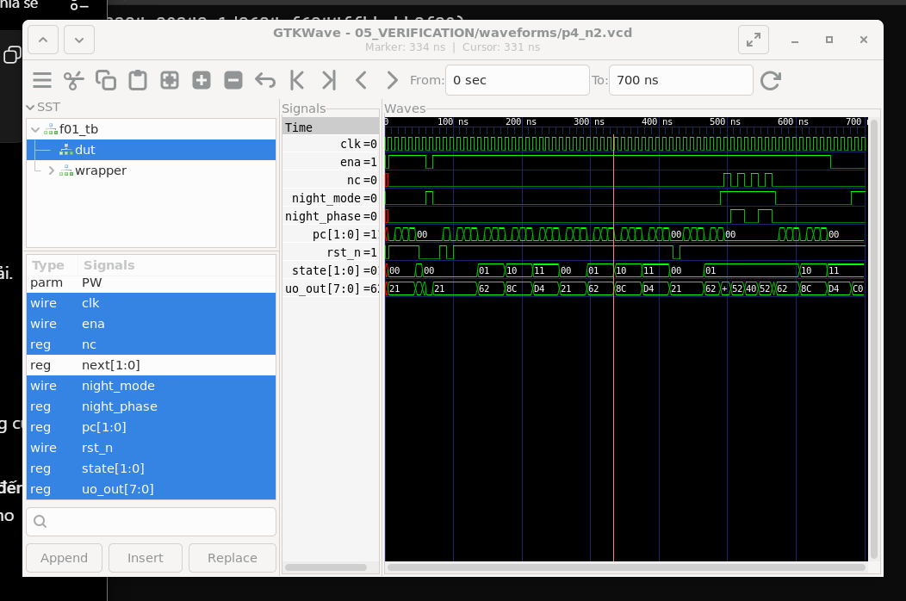
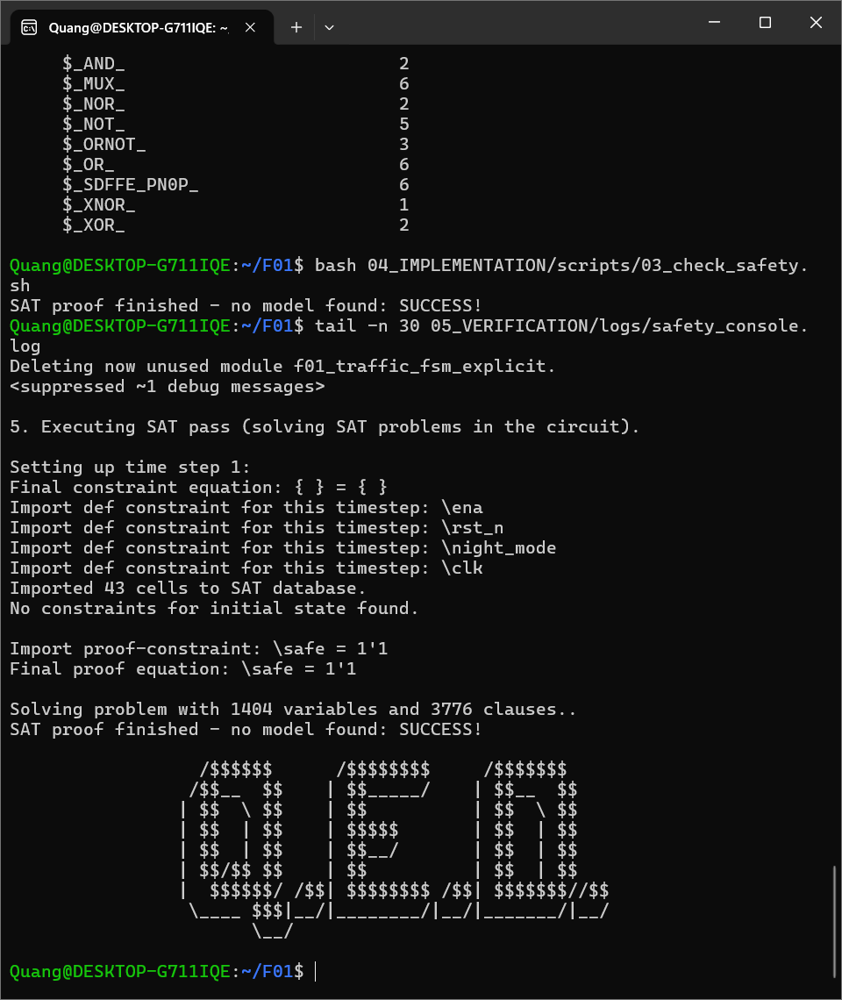
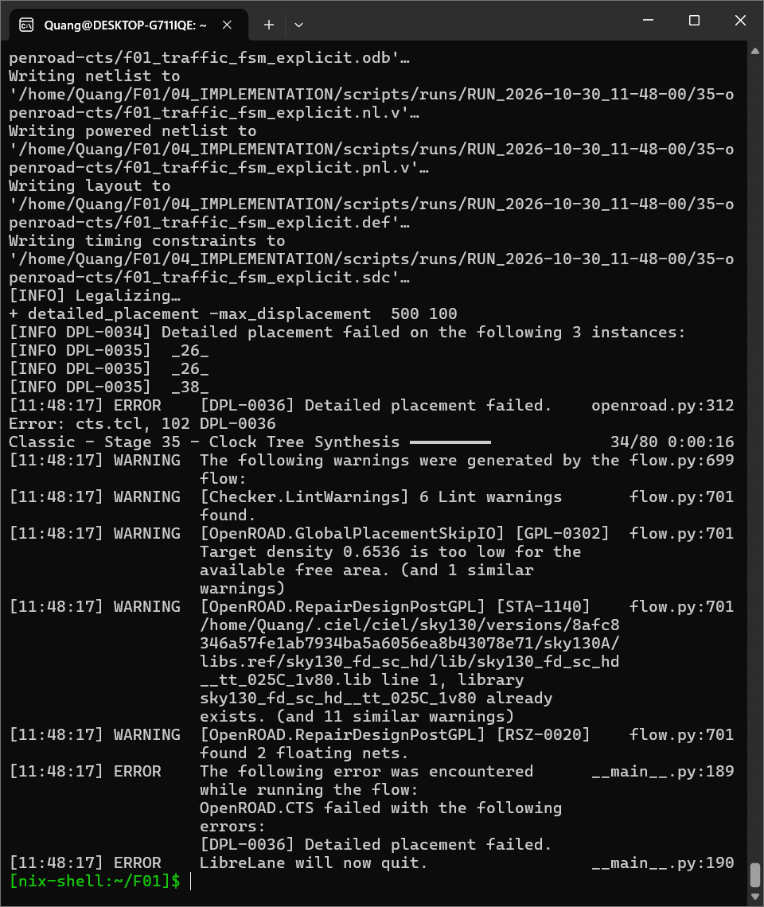
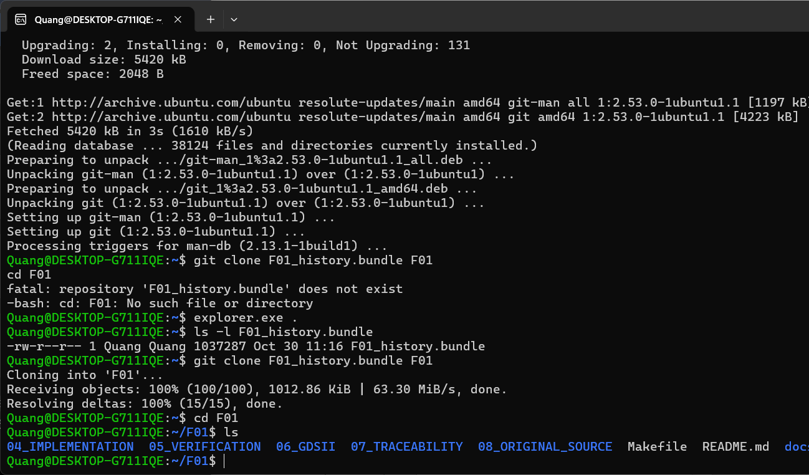
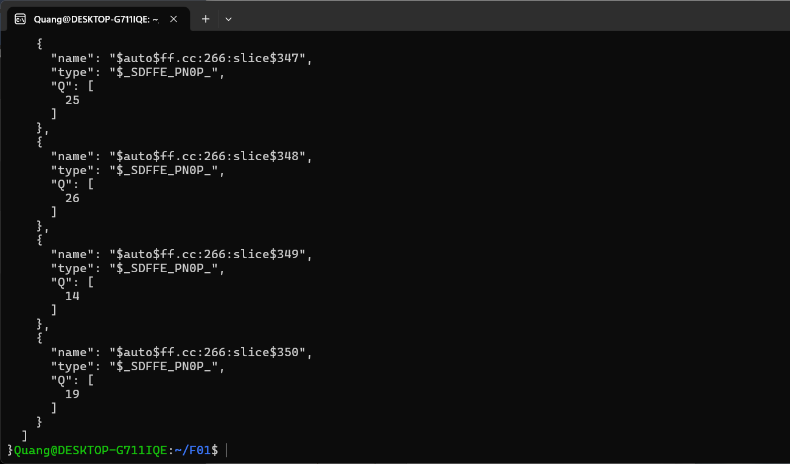
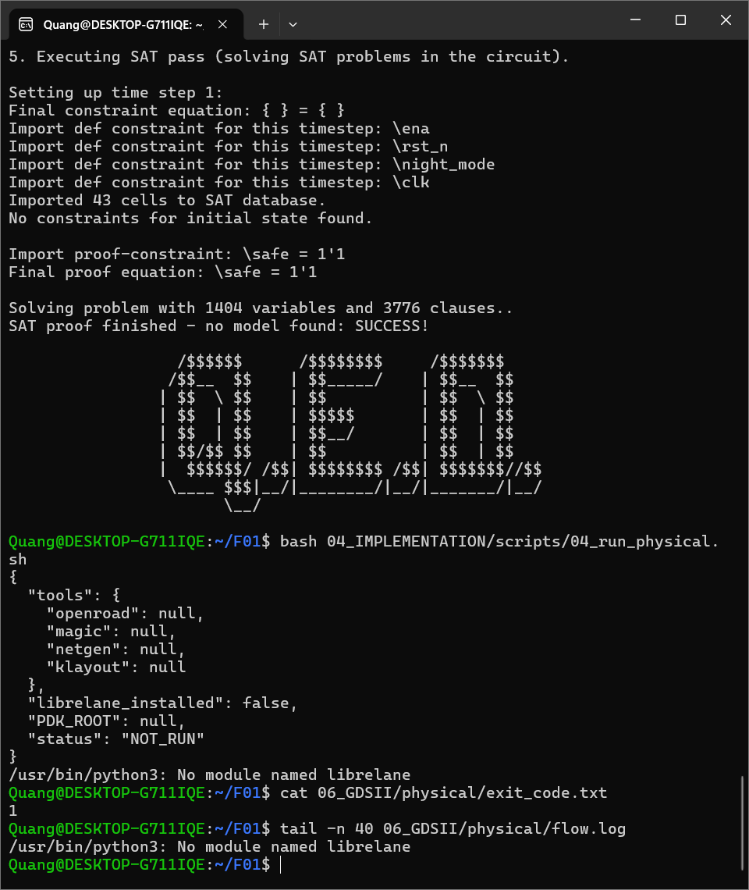

# Ảnh minh chứng F01 trên máy sinh viên

[Quay lại trang chính](../../README.md)

Các ảnh dưới đây được sinh viên cung cấp ngày 30/10/2026. File ảnh được giữ nguyên nội dung, chỉ đổi tên để dễ tra cứu. Bảng này là mục lục; bấm tên để mở ảnh đầy đủ.

| Ảnh | Chứng minh được | Giới hạn |
|---|---|---|
| [01 Khôi phục dự án trong Ubuntu](01_khoi_phuc_du_an_ubuntu.png) | Git clone từ bundle hoàn tất, đã vào thư mục F01. | Không phải bằng chứng mô phỏng hay CI đạt. |
| [02 Dạng sóng GTKWave 0-700 ns](02_waveform_gtkwave_0_700ns.png) | Có state, pc, rst_n, ena, night_mode, night_phase và uo_out. | Đây là ảnh tổng quan; các ảnh nhập nhầm From theo giây không dùng để phân tích. |
| [03 Danh sách FF](03_danh_sach_flip_flop.png) | Hiển thị phần cuối danh sách FF và các bit Q. | Không hiển thị toàn bộ thống kê tổng hợp. |
| [04 SAT SUCCESS và 6 FF](04_sat_success_va_6_ff.png) | SAT SUCCESS; thống kê có 6 cell $_SDFFE_PN0P_. | 43 cell được nạp trong SAT là cấu trúc ở bước chứng minh, không phải số cell sau ánh xạ. |
| [05 Lỗi môi trường ban đầu](05_loi_thieu_librelane.png) | Python chưa tìm thấy LibreLane; lần thử trả về 1. | Đây là lỗi trước khi bổ sung môi trường, không phải trạng thái mới nhất. |
| [06 Lỗi CTS sau khi bổ sung môi trường](06_flow_dung_o_cts_dpl0036.png) | Flow đi tới OpenROAD.CTS rồi lỗi DPL-0036 tại 3 instance. | Chưa xác nhận hoàn tất routing, GDS, STA sau routing, DRC/LVS. |

## Đọc dạng sóng ban ngày

- `state[1:0]` lần lượt có 00, 01, 10, 11.
- Ở ban ngày, `uo_out` tương ứng là 0x21, 0x62, 0x8C, 0xD4; hai bit cao là mã pha.
- `pc` đếm thời lượng pha, về 0 khi chuyển pha.
- Trong đoạn chế độ đêm được quan sát, `state` giữ 01, `pc` về 0; `uo_out` luân phiên 0x52 và 0x40, lần lượt là hai đèn vàng sáng và tắt với mã pha vẫn 01.
- `ena = 0` khóa thanh ghi; ngõ ra còn phụ thuộc tổ hợp vào `night_mode`.

Các hình vẽ gọn để trình bày nằm tại [wave_day.png](../figures/wave_day.png) và [wave_night.png](../figures/wave_night.png). Hai hình này được tạo từ trace của lần chạy tham chiếu 28/10/2026, không phải ảnh chụp GTKWave ngày 30/10.

## Kiểm tính chất an toàn

Lệnh chạy: `bash 04_IMPLEMENTATION/scripts/03_check_safety.sh`.

Kết quả hiển thị: `SAT proof finished - no model found: SUCCESS!`. Thuộc tính được chứng minh là `safe = !(uo_out[0] && uo_out[3])` trong mô hình logic ổn định; không đánh giá glitch vật lý hoặc an toàn toàn hệ thống đèn thật.

## Truy vết lỗi flow

Lần chạy được quan sát là `RUN_2026-10-30_11-48-00`. Bước 35 là Clock Tree Synthesis; OpenROAD báo detailed placement thất bại. Xem [chẩn đoán và lần thử khắc phục](../CHAN_DOAN_FLOW.md).

## Các ảnh bổ sung

### Dự án đã được khôi phục trong Ubuntu

### Phần cuối danh sách flip-flop

### Lỗi thiếu môi trường trước khi mở LibreLane

